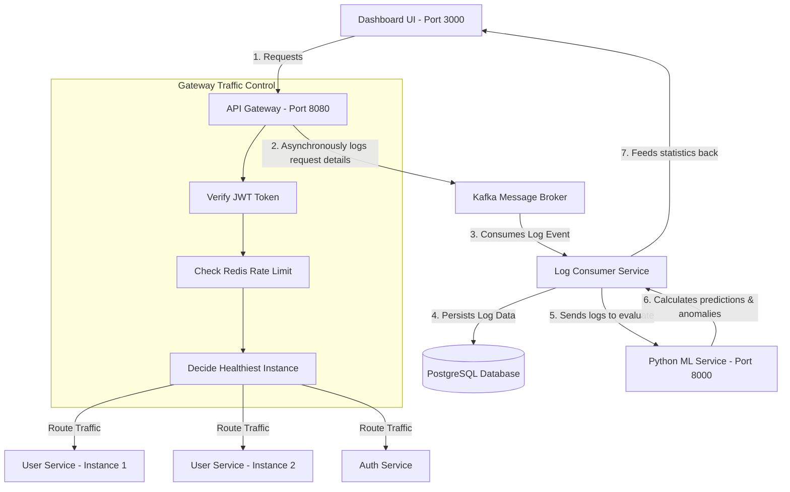

# 🚀 Nexus Gateway — AI-Powered Smart API Gateway & Traffic Optimization System

Enterprise-grade distributed microservice system featuring an API Gateway, JWT Authentication, Redis Rate Limiting, Kafka Logging, a Python FastAPI Machine Learning Engine (RandomForest load forecasting & IsolationForest anomaly detection), and a real-time React Analytics Dashboard.

---

## 🍽️ The Restaurant Analogy (How it Works)

To make it simple, think of the **Nexus** system as a busy premium restaurant:

1. **The Customer (Client / Browser)**: You sit at a table and place orders, check profiles, or request notifications.
2. **The Head Waiter (API Gateway - :8080)**: Intercepts all requests.
   * **Verification**: Checks your VIP card (JWT Token) before serving you (**401 Unauthorized** if missing).
   * **Anti-Spam**: Prevents you from placing more than 100 orders in a single minute (**429 Too Many Requests** if exceeded).
3. **The Kitchen Stations (Microservices)**: 
   * **Bread Station (`user-service`)**: Staffed by two chefs (Chef A/Instance 1 on `:8082` and Chef B/Instance 2 on `:8092`) to handle heavy load.
   * **Dessert Station (`payment-service`)**: Processes payments.
   * **Drink Station (`notification-service`)**: Dispatches alerts.
4. **The Head Waiter's Clipboard (Smart Routing)**: The Head Waiter reads a clipboard (**Redis Cache**) showing how fast Chef A and Chef B are cooking. If Chef A gets slow or drops a plate, the waiter dynamically routes new orders to Chef B.
5. **The Order Ticket Machine (Kafka + Log Consumer)**: Every taken order prints a ticket onto a conveyor belt (**Kafka Broker**). A helper (**Log Consumer Service - :8085**) files them in the restaurant's records cabinet (**PostgreSQL Database - :5432**) without slowing down the waiters.
6. **The Restaurant Analyst (Python ML Service - :8000)**: Reads database logs to forecast Friday night crowds (**RandomForest Traffic Forecast**) and detect table pranks (**IsolationForest anomaly detection** for request floods or response timeouts).
7. **The Owner's Monitor (React Dashboard - :3000)**: A real-time screen showing how many orders are processed, average chef response speed, error rates, and red warning indicators when the AI analyst detects spam.

---

## 📐 Architecture & Data Flow



---

## 📦 Service Port Matrix

| Service Name | Host Port | Internal Port | Description |
| :--- | :--- | :--- | :--- |
| **frontend** | `3000` | `80` | React analytics dashboard & admin UI |
| **gateway-service** | `8080` | `8080` | Spring Cloud Gateway (circuit breakers, rate limiting, logging) |
| **auth-service** | `8081` | `8081` | Core identity, UUID registration, and JWT creation |
| **user-service-1** | `8082` | `8082` | User profile service (Instance 1) |
| **user-service-2** | `8092` | `8082` | User profile service (Instance 2) |
| **payment-service-1** | `8083` | `8083` | Transactions service (Instance 1) |
| **payment-service-2** | `8093` | `8083` | Transactions service (Instance 2) |
| **notification-service-1**| `8084` | `8084` | User alert and notification dispatch (Instance 1) |
| **notification-service-2**| `8094` | `8084` | User alert and notification dispatch (Instance 2) |
| **log-consumer-service**| `8085` | `8085` | Kafka consumer + ML orchestrator + Dashboard backend |
| **ml-service** | `8000` | `8000` | FastAPI Python service (RandomForest & IsolationForest) |
| **postgres** | `5432` | `5432` | PostgreSQL relational persistent database |
| **redis** | `6379` | `6379` | Redis cache for rate limiting, health scores, and dynamic policies |
| **kafka** | `9092` | `9092` | Apache Kafka message broker |
| **zookeeper** | `2181` | `2181` | Kafka cluster coordination manager |
| **prometheus** | `9090` | `9090` | Time-series scraper for actuator metrics |
| **grafana** | `3001` | `3000` | Metrics dashboard visualizer (admin/admin) |

---

## 🚀 How to Run the Application

The entire multi-service stack is optimized to run inside Docker with shared dependency caching to speed up the builds by up to 10x.

### Steps to Start:
1. Ensure **Docker Desktop** is open and running on your host machine.
2. Open a terminal at the project root folder.
3. Run the startup command:
   ```bash
   docker compose up --build
   ```
4. Wait 2-3 minutes for compilation, dependencies downloads, and container health checks to report healthy.
5. Open your browser and navigate to **[http://localhost:3000](http://localhost:3000)**.

---

## 🔑 Default Credentials

To authenticate requests or log into the dashboard:
* **Email**: `admin@nexus.com`
* **Password**: `admin123`

---

## 📊 Understanding Dashboard Metrics

1. **Total Requests**: The aggregate number of requests that have crossed the API Gateway.
2. **Req / Minute (RPM)**: Live speed of traffic currently hitting the gateway.
3. **Avg Response (ms)**: The average time taken by your backend microservices to respond.
4. **Error Rate (%)**: Tracks transaction failure rates. Blocks caused by rate-limiting (**`429 Too Many Requests`**) are logged as errors here to help you identify active attacks or abusive clients.
5. **Requests Per Minute Chart**: A graphical timeline displaying live load and request spikes.
6. **Top APIs Chart**: Visualizes load distributions, showing which microservice receives the most traffic.
7. **Recent Requests Table**: Audit trail displaying Request ID (UUID), HTTP Method, Endpoint, Status Code, User ID, and Client IP.

---

## 🧪 E2E Verification & Testing

To run verification scripts for JWT auth validation, simulate rate-limits (exceeding 100 req/min), inspect database telemetry logs, or evaluate ML forecasts, refer to the step-by-step testing instructions:

👉 **[VERIFICATION_GUIDE.md](./VERIFICATION_GUIDE.md)**
